# Application Design Patterns: Problems, Products and Mechanisms

**Revised instructor edition | Graduate CS | 180 minutes including two 10-minute breaks**

The lecture begins with monoliths. Every core pattern follows: definition -> problem -> documented product case -> implementation -> request/update walkthrough -> why it works and what it costs.

## Run of show

| Clock | Chapter | Minutes |
|---|---|---:|
| 00:00-00:12 | Opening + monolith | 12 |
| 00:12-00:25 | Modular monolith | 13 |
| 00:25-00:45 | Microservices | 20 |
| 00:45-01:00 | Event-driven architecture | 15 |
| 01:00-01:10 | Break | 10 |
| 01:10-01:40 | CQRS | 30 |
| 01:40-02:00 | Cache hierarchy | 20 |
| 02:00-02:20 | Edge delivery / CDN | 20 |
| 02:20-02:30 | Break | 10 |
| 02:30-02:50 | Online recommendation pipeline | 20 |
| 02:50-03:00 | Synthesis | 10 |

## Teaching and evidence conventions

- The PPTX uses editable native architecture shapes and has full notes. The self-contained HTML works offline: arrows/Space navigate, N toggles notes, F enters fullscreen. Source links require a network connection.
- Markdown contains the same visible content and expanded teaching guidance. Keep the adjacent `diagrams` folder, or use the ZIP bundle. Every diagram also has a textual path equivalent.
- Original diagrams are simplified reconstructions or explicitly labeled teaching extensions, not proprietary/current full company blueprints.
- Company outcomes are dated, sourced reports. Hypothetical IDs, workloads and API names are identified in the notes. No pattern is presented as a universal upgrade.
- **CQRS distinction:** separate write/read models do not themselves guarantee immediate propagation or reconcile conflicting global writes. Tudum retained the separation while changing its implementation.
- **Tudum provenance:** the original Netflix TechBlog host returned HTTP 403. The attributed full-text republication S5R was inspected; reported measurements are labeled as such.

## Slide index
- [01. Patterns begin with a problem](#slide-01)
- [02. Monolith: one application, one release](#slide-02)
- [03. Shopify first needed a working commerce platform](#slide-03)
- [04. Walk one checkout through the monolith](#slide-04)
- [05. Why this works - and where it stops](#slide-05)
- [06. Modular monolith: boundaries inside the application](#slide-06)
- [07. Shopify: shipping changes could break tax behavior](#slide-07)
- [08. Shopify reorganized code, not the network](#slide-08)
- [09. Walk the replacement of a tax engine](#slide-09)
- [10. Shopify made its tax-engine swap feasible](#slide-10)
- [11. Microservices: independently deployed capabilities](#slide-11)
- [12. Netflix: a three-day DVD shipping outage](#slide-12)
- [13. Separate the member experience](#slide-13)
- [14. Walk a browse request when ranking is slow](#slide-14)
- [15. Timeout: did the remote write happen?](#slide-15)
- [16. Netflix changed both architecture and operations](#slide-16)
- [17. Events: publish once, react independently](#slide-17)
- [18. LinkedIn needed a shared data backbone](#slide-18)
- [19. Put the log between producers and consumers](#slide-19)
- [20. Walk a profile change through the log](#slide-20)
- [21. Decoupled timing still needs ownership](#slide-21)
- [22. Break - return at minute 70](#slide-22)
- [23. CQRS: different models for changing and reading data](#slide-23)
- [24. Netflix Tudum had two very different users](#slide-24)
- [25. Tudum: CMS to read-optimized pages](#slide-25)
- [26. Publish is accepted. Is it visible yet?](#slide-26)
- [27. Why is Tudum's read path cheaper?](#slide-27)
- [28. The new problem: previews were too stale](#slide-28)
- [29. Keep CQRS; simplify data distribution](#slide-29)
- [30. Tudum: faster previews and less request-time I/O](#slide-30)
- [31. CQRS is a model decision - not a replication protocol](#slide-31)
- [32. Cache hierarchy: avoid repeated storage I/O](#slide-32)
- [33. Facebook: graph reads were costly](#slide-33)
- [34. TAO put graph operations behind one access layer](#slide-34)
- [35. A like written in one region has to reach other copies](#slide-35)
- [36. TAO centralized graph-read coordination](#slide-36)
- [37. When the hottest cache entry disappears](#slide-37)
- [38. Edge delivery: put reusable bytes near the reader](#slide-38)
- [39. Netflix: video needs a separate data path](#slide-39)
- [40. Open Connect: appliances, peering and content fill](#slide-40)
- [41. Walk pressing Play, then losing the local appliance](#slide-41)
- [42. Locality and adaptation are different](#slide-42)
- [43. Local traffic, distributed operations](#slide-43)
- [44. Break - return at minute 150](#slide-44)
- [45. Online recommendation: close the feedback loop](#slide-45)
- [46. TikTok makes the freshness problem visible](#slide-46)
- [47. Monolith: turn events into training data](#slide-47)
- [48. Walk one watch event back into later predictions](#slide-48)
- [49. Why not copy the whole model after every event?](#slide-49)
- [50. Fresher learning is not free intelligence](#slide-50)
- [51. Match the mechanism to the bottleneck](#slide-51)
- [52. Diagnose CampusStream before drawing more boxes](#slide-52)
- [53. A defensible answer has four parts](#slide-53)
- [54. Coalescing: share one in-flight query](#slide-54)
- [55. Discord improved the whole storage path](#slide-55)
- [56. Patterns still need an operating environment](#slide-56)
- [57. Put the pattern inside a global deployment](#slide-57)
- [58. Sources / S1, S2, S3](#slide-58)
- [59. Sources / S4, S5, S5R](#slide-59)
- [60. Sources / S6, S7, S8](#slide-60)
- [61. Sources / S9, S10, S11](#slide-61)

---

## 01. Patterns begin with a problem

**Start here / ROADMAP | 00:00-00:02 | 2 min**

> Define the pattern. Meet the product problem. Trace the implementation. Explain the result.

### First hour

Monolith -> modular monolith -> microservices -> event-driven architecture.

### Second hour

CQRS in depth -> Facebook's distributed cache hierarchy.

### Final hour

Netflix edge delivery -> TikTok/ByteDance recommendation pipelines -> design discussion.

### Instructor explanation and discussion

This is a three-hour graduate CS lecture including two ten-minute breaks at minutes 60 and 140. The sequence is not a mandatory maturity ladder. Each chapter follows the same rhythm: identify and define the pattern, identify the problem it addresses, introduce a real product's documented difficulty, explain implementation with an original diagram, trace a concrete request or update, and evaluate benefits and costs. Start the next slide immediately with monolith; networking is explained in the context of each case rather than as a long preliminary survey. The optional appendix is outside the teaching clock. Dates in source labels matter: these are historical decisions, not assertions about complete current company stacks. Engineering sources support the case; schematic user actions and deployment controls are explicitly teaching extensions.

---

## 02. Monolith: one application, one release

**01 Monolith / DEFINE | 00:02-00:04 | 2 min**

> A single deployable contains multiple business capabilities; most internal calls stay in process.

### Problem it solves

A team needs to deliver an end-to-end product without coordinating a distributed service system.

### How it works

Route requests to application replicas. Domain code uses local calls and can share a database transaction.

### Instructor explanation and discussion

A monolith is a deployment boundary, not a requirement to use one server, one class, one language or unstructured code. Presentation, business rules and storage adapters can still be layered. One deployable can have many identical replicas behind a load balancer. The main advantage is simplicity of changing, testing and operating the entire application. A transaction can span local domain work when the data lives in one transactional database; an external payment gateway still lies outside that transaction. Ask students what a normal function call gives them that an HTTP call does not: a shared process, synchronous errors and no ambiguous network timeout. Do not equate 'monolithic' with 'bad'.

---

## 03. Shopify first needed a working commerce platform

**01 Monolith / REAL PROBLEM | 00:04-00:07 | 3 min**

> Catalogs, checkout, shipping and billing had to become one coherent product.

### The real case

Shopify's 2019 account describes an initially monolithic Rails codebase that supported many business capabilities.

### Why the pattern fit

One codebase and deployment path kept local calls, shared data access and development operations straightforward.

### Instructor explanation and discussion

S1 describes why the monolithic approach worked for Shopify for many years before its costs grew. It explicitly discusses one repository, one testing/deployment pipeline, simpler infrastructure and in-process calls. Do not invent a founding-team size, exact initial request rate or measured development speedup; the article does not establish those. Connect the familiar shopping experience to the architecture: a shopper needs product details, an order and shipping information to agree. The monolith keeps coordination local. This is a case where the problem being solved is product delivery complexity, not a reported outage. Ask why introducing five services before the business boundaries stabilize could slow that work.

**Sources:** [S1: Shopify: Deconstructing the Monolith](https://shopify.engineering/deconstructing-monolith-designing-software-maximizes-developer-productivity).

---

## 04. Walk one checkout through the monolith

**01 Monolith / IMPLEMENT + TRACE | 00:07-00:10 | 3 min**

> Public ingress is separate from application structure; a monolith still needs a production network.

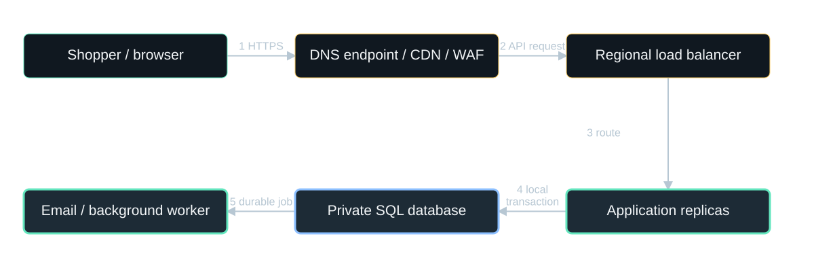

**Diagram scope:** Teaching deployment: DNS resolves first; private app/data paths use firewalls, TLS and identity. A monolith may have many replicas.

**Text equivalent:**
- Shopper / browser -> DNS endpoint / CDN / WAF: 1 HTTPS.
- DNS endpoint / CDN / WAF -> Regional load balancer: 2 API request.
- Regional load balancer -> Application replicas: 3 route.
- Application replicas -> Private SQL database: 4 local transaction.
- Private SQL database -> Email / background worker: 5 durable job.

**Highlighted:** Application replicas, Private SQL database, Email / background worker.

### Follow 1-3

DNS selects an edge endpoint; HTTPS reaches CDN/WAF and then a regional load balancer.

### Follow 4-5

An app replica validates the order, commits local stock/order changes and records asynchronous email work.

### Instructor explanation and discussion

The deployment diagram is a teaching reconstruction, not Shopify's exact infrastructure. DNS resolves names and does not carry the later HTTP request. The CDN can serve public static assets; personalized checkout is not a shared cache hit. DDoS protection and a WAF filter traffic before regional ingress. Application replicas and the database use private network paths, allowlisted ports and workload identities; the database is not public. TLS and object-level authorization remain necessary even inside a private network. Use an atomic stock predicate such as stock >= requested quantity to protect the last item. Commit the order and durable job intent together, then send email after commit. Payment uncertainty is a separate workflow concern. Session state must survive routing to another replica. Logs, backups, secrets and deployment pipelines are operating responsibilities, not reasons to split the application.

**Sources:** [S1: Shopify: Deconstructing the Monolith](https://shopify.engineering/deconstructing-monolith-designing-software-maximizes-developer-productivity).

---

## 05. Why this works - and where it stops

**01 Monolith / WHY / LIMIT | 00:10-00:12 | 2 min**

> The benefit comes from fewer coordination boundaries, not from a magical framework.

### Benefit

Local calls and local transactions reduce latency, failure cases and deployment coordination.

### Cost

A shared release/runtime can couple unrelated changes. Replicating the app does not fix a tangled dependency graph.

### Instructor explanation and discussion

Have students distinguish throughput from changeability. A monolith may scale by adding replicas, indexes and carefully chosen caches. If a change to taxes unexpectedly breaks shipping, more servers do not solve the problem. A larger team may find that too much implicit knowledge is required to make safe changes. Those are pressures for boundaries; they are not yet proof that boundaries must be network services. Transition directly to Shopify's actual problem: reducing coupling without taking on distributed-system overhead.

**Sources:** [S1: Shopify: Deconstructing the Monolith](https://shopify.engineering/deconstructing-monolith-designing-software-maximizes-developer-productivity).

---

## 06. Modular monolith: boundaries inside the application

**02 Modular monolith / DEFINE | 00:12-00:14 | 2 min**

> One deployable, but each business domain has an explicit API and owns its data access.

### Problem it solves

Unrelated capabilities are so entangled that small code changes have unpredictable consequences.

### How it works

Organize by business domain; expose a small public interface; detect or prevent calls into module internals.

### Instructor explanation and discussion

Compare a module API with a service API. A module API is usually an in-process interface, not HTTP. Ownership can be enforced even with one physical database: another module cannot freely query or mutate its tables. This architecture preserves local deployment and transaction options while reducing accidental coupling. A folder rename alone does not create modularity. The rules must affect dependencies, testing and data access. Ask whether MVC folders represent business boundaries; generally models/views/controllers organize technical concerns, whereas orders/shipping/tax represent business capabilities.

**Sources:** [S1: Shopify: Deconstructing the Monolith](https://shopify.engineering/deconstructing-monolith-designing-software-maximizes-developer-productivity).

---

## 07. Shopify: shipping changes could break tax behavior

**02 Modular monolith / REAL PROBLEM | 00:14-00:17 | 3 min**

> By 2016, coupling was making the codebase fragile and difficult to learn.

### Before

Business domains called each other's internals; developers needed broad system context to change one feature.

### The decision

Keep one application, but reorganize and isolate domains. Do not pay for microservices unless distribution is needed.

### Instructor explanation and discussion

S1 describes unexpected test failures, high coupling, slow tests and difficult onboarding. Its shipping/tax example illustrates how an innocuous change could have surprising consequences. The componentization effort began in early 2017, informed by a developer survey. Shopify considered the overhead of multiple pipelines, remote calls, infrastructure and coordinated cross-service refactors. Present the decision as specific to these forces, not as proof that Shopify rejected every service. The article describes a journey; it does not say all boundaries were already perfectly enforced in 2019.

**Sources:** [S1: Shopify: Deconstructing the Monolith](https://shopify.engineering/deconstructing-monolith-designing-software-maximizes-developer-productivity).

---

## 08. Shopify reorganized code, not the network

**02 Modular monolith / IMPLEMENT | 00:17-00:20 | 3 min**

> Business-domain components became the unit of ownership.

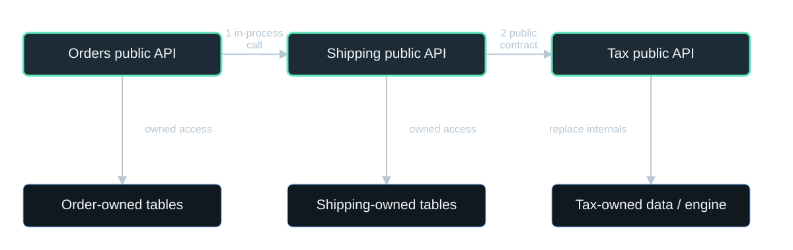

**Diagram scope:** One deployable. Blue boxes show logical ownership; they need not be separate physical databases.

**Text equivalent:**
- Orders public API -> Shipping public API: 1 in-process call.
- Shipping public API -> Tax public API: 2 public contract.
- Orders public API -> Order-owned tables: owned access.
- Shipping public API -> Shipping-owned tables: owned access.
- Tax public API -> Tax-owned data / engine: replace internals.

**Highlighted:** Orders public API, Shipping public API, Tax public API.

### 1 | Organize

Move code into domains such as orders, shipping, inventory and billing.

### 2 | Isolate

Expose public component APIs; make data ownership explicit; find boundary violations.

### Instructor explanation and discussion

The schematic shows representative modules, not an exhaustive Shopify module map. Orders calls a shipping API, and shipping uses a tax API rather than reaching into the tax implementation. Blue boxes represent module-owned data within a shared database system, not independently deployed databases. S1 reports classifying about 6,000 Ruby classes, then moving files with automated scripts. Moving files made the structure visible, but dependency isolation did the architectural work. Mention Wedge: Ruby tracepoints during CI produced cross-component call information; analysis also considered ActiveRecord associations and inheritance. Wedge exposed violations so teams could improve boundaries. The article described stronger runtime enforcement as future work, so do not claim it was already universally active.

**Sources:** [S1: Shopify: Deconstructing the Monolith](https://shopify.engineering/deconstructing-monolith-designing-software-maximizes-developer-productivity).

---

## 09. Walk the replacement of a tax engine

**02 Modular monolith / TRACE | 00:20-00:23 | 3 min**

> Change the implementation behind the tax boundary rather than changing every caller.

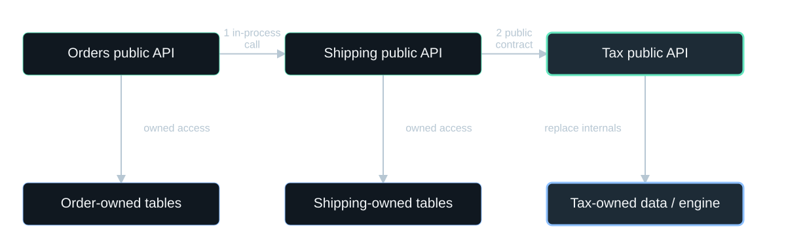

**Diagram scope:** One deployable. Blue boxes show logical ownership; they need not be separate physical databases.

**Text equivalent:**
- Orders public API -> Shipping public API: 1 in-process call.
- Shipping public API -> Tax public API: 2 public contract.
- Orders public API -> Order-owned tables: owned access.
- Shipping public API -> Shipping-owned tables: owned access.
- Tax public API -> Tax-owned data / engine: replace internals.

**Highlighted:** Tax public API, Tax-owned data / engine.

### Before the swap

Callers depend on Tax.calculate(...) and its contract, not the legacy engine's internal classes.

### During the swap

Implement the same contract with the new engine; test compatibility and migrate internal data carefully.

### Instructor explanation and discussion

The specific API name is illustrative; the real outcome is documented in S1: isolating dependencies made it possible to replace a legacy tax engine with a new tax calculation system. Walk through an order asking for shipping/tax, the public module interface, its internal engine and its owned data. Highlight the tax module and data only. Explain why this localizes change: callers do not know implementation details. Behavioral compatibility still matters, including rounding and jurisdiction rules. Tests must cover the old public contract, migration and the new required behavior. A module boundary cannot make a deliberate breaking contract change invisible.

**Sources:** [S1: Shopify: Deconstructing the Monolith](https://shopify.engineering/deconstructing-monolith-designing-software-maximizes-developer-productivity).

---

## 10. Shopify made its tax-engine swap feasible

**02 Modular monolith / RESULT + DISCUSS | 00:23-00:25 | 2 min**

> Shopify reported replacing its tax engine after isolating dependencies.

### Why it helped

Less knowledge leaked across module boundaries; in-process communication and one deployment were preserved.

### Discussion

A module is CPU-bound, but the rest of the app is not. When would independent service scaling be worth the added cost?

### Instructor explanation and discussion

This is a qualitative reported outcome, not a measured percentage improvement. Ask for an extraction criterion: independent deployment ownership, divergent resource needs or a justified fault-isolation boundary. A good answer measures the bottleneck and accounts for operating a remote service. A weak answer says all large applications must eventually become microservices. Transition to Netflix, where availability, capacity and global operation created different forces.

**Sources:** [S1: Shopify: Deconstructing the Monolith](https://shopify.engineering/deconstructing-monolith-designing-software-maximizes-developer-productivity).

---

## 11. Microservices: independently deployed capabilities

**03 Microservices / DEFINE | 00:25-00:28 | 3 min**

> Separate business capabilities communicate through explicit network contracts.

### Problem it solves

Teams or workloads need independent scaling, release cadence and fault isolation.

### Mechanism

Give services clear ownership, contracts and data access; deploy and scale them independently.

### Instructor explanation and discussion

A process is not automatically a microservice. The boundary needs a coherent responsibility and an owner. If every change requires coordinated release of every service, the system is still tightly coupled, now with network failure modes. A service may use the same physical managed database infrastructure as another while maintaining logical data ownership; cross-service table writes undermine autonomy. API gateways handle common ingress concerns; backend-for-frontend composition adapts data to clients. Neither removes downstream dependency management. Explain latency budgets, discovery, workload identity, schema compatibility and tracing as consequences of moving a function call across a network.

---

## 12. Netflix: a three-day DVD shipping outage

**03 Microservices / REAL PROBLEM | 00:28-00:31 | 3 min**

> The August 2008 failure exposed vertically scaled single points of failure.

### The reported problem

Netflix needed greater reliability, rapid capacity growth and eventually global operation.

### The architectural response

Rebuild toward horizontally scalable cloud systems and hundreds of microservices - not simply move the old application.

**3 days** - DVD shipping interruption reported for the 2008 incident.

### Instructor explanation and discussion

S2 states the 2008 database corruption prevented DVD shipments for three days. This was not a three-day worldwide streaming outage; keep the distinction explicit. The report says the cloud migration completed in early 2016 after seven years. It describes microservices, denormalized/NoSQL data models, independent engineering decisions and continuous delivery. Cloud and microservices were parts of a broader transformation; do not claim splitting processes alone cured corruption or created reliability. The source also distinguishes cloud application compute from video delivery through Open Connect, which appears later.

**Sources:** [S2: Netflix: Completing the Netflix Cloud Migration](https://about.netflix.com/news/completing-the-netflix-cloud-migration).

---

## 13. Separate the member experience

**03 Microservices / IMPLEMENT | 00:31-00:35 | 4 min**

> Use a small composition layer; keep business ownership behind service interfaces.

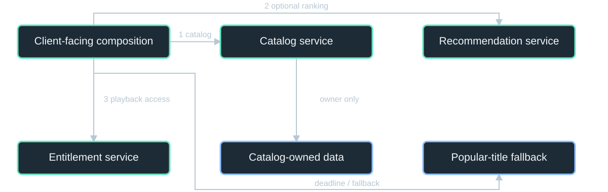

**Diagram scope:** Netflix-inspired teaching topology, not an exact service map. Each regional service has replicas, bounded concurrency and private authenticated access.

**Text equivalent:**
- Client-facing composition -> Catalog service: 1 catalog.
- Client-facing composition -> Recommendation service: 2 optional ranking.
- Client-facing composition -> Entitlement service: 3 playback access.
- Catalog service -> Catalog-owned data: owner only.
- Client-facing composition -> Popular-title fallback: deadline / fallback.

### Application path

A client-facing layer composes catalog, recommendations and entitlement information.

### Deployment path

Replicas across availability zones; regional ingress, private service networking and independently managed capacity.

### Instructor explanation and discussion

This is a simplified teaching topology illustrating S2's documented microservice migration, not an exact Netflix service inventory. Catalog and recommendation calls can run concurrently if independent. Entitlement must be checked for playback, not skipped because another dependency is down. The load balancer and application services sit behind DNS, TLS, DDoS/WAF controls and gateway rate limits. Private network rules restrict east-west traffic; services authenticate workloads, and user permissions are checked at the relevant resource. Databases are owned by services rather than freely joined by the frontend. Global routing can send requests to healthy regional capacity only if data ownership and residency allow it. Multiple AZs protect against one infrastructure failure domain; they do not prove regional recovery.

**Sources:** [S2: Netflix: Completing the Netflix Cloud Migration](https://about.netflix.com/news/completing-the-netflix-cloud-migration).

---

## 14. Walk a browse request when ranking is slow

**03 Microservices / TRACE | 00:35-00:39 | 4 min**

> The page may still render without a live recommendation response.

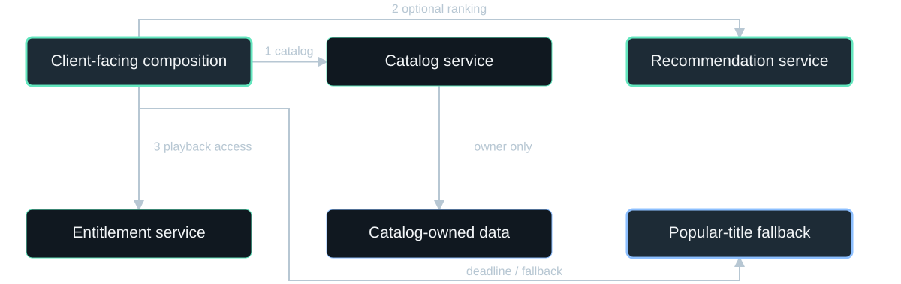

**Diagram scope:** Netflix-inspired teaching topology, not an exact service map. Each regional service has replicas, bounded concurrency and private authenticated access.

**Text equivalent:**
- Client-facing composition -> Catalog service: 1 catalog.
- Client-facing composition -> Recommendation service: 2 optional ranking.
- Client-facing composition -> Entitlement service: 3 playback access.
- Catalog service -> Catalog-owned data: owner only.
- Client-facing composition -> Popular-title fallback: deadline / fallback.

**Highlighted:** Client-facing composition, Recommendation service, Popular-title fallback.

### 1 | Bound optional work

Set a recommendation deadline; cap concurrent requests; stop sending traffic when failure persists.

### 2 | Preserve essential behavior

Use a permitted fallback such as popular titles. Never replace entitlement validation with an optimistic success.

### Instructor explanation and discussion

The exact browse flow is illustrative; Netflix's historical Hystrix provides documented evidence for latency/fault isolation, bulkheads, circuit breakers and fallbacks. Explain the sequence: request enters the composition layer, independent data is fetched, the recommendation call exceeds its budget, a safe fallback is selected and the response completes. A timeout limits one wait; a circuit breaker prevents repeated calls to a failing dependency; a bulkhead keeps one dependency from exhausting shared capacity. Cancellation and bounded queues prevent work from continuing indefinitely after callers leave. Hystrix is in maintenance mode, so teach the pattern rather than recommend it as a new project dependency. Ask which failure should block playback and why.

**Sources:** [S11: Netflix Hystrix](https://github.com/Netflix/Hystrix).

---

## 15. Timeout: did the remote write happen?

**03 Microservices / FAILURE + DATA | 00:39-00:42 | 3 min**

> The price of autonomy is explicit coordination.

### Concrete failure

An order service times out after a payment service accepted a charge. A blind retry may charge twice.

### Implementation response

Stable idempotency keys, durable workflow state and reconciliation; use local transactions and compensating actions where needed.

### Instructor explanation and discussion

This checkout scenario is an illustrative distributed workflow, not an assertion about Netflix billing. A saga is a sequence of local transactions with business compensation; it is not an ACID rollback across services. Explain that an outbox can commit a business change and an event intent in one local database transaction, then relay it to a broker. The relay can duplicate messages, so consumers need deduplication coupled atomically to their effects. External payment APIs need their own idempotency mechanisms. Introduce these as costs that can erase the benefit of premature service extraction. Independent database ownership has real consequences.

---

## 16. Netflix changed both architecture and operations

**03 Microservices / RESULT + LIMIT | 00:42-00:45 | 3 min**

> The 2016 report credits elasticity, redundancy, graceful degradation and organizational autonomy.

### Reported outcome

Global cloud capacity, faster provisioning and improved availability accompanied the migration.

### Not a universal prescription

Seven years of redesign and new operating skills. A small CRUD team may get less value than complexity.

### Instructor explanation and discussion

S2 reports multiple cloud regions, expansion into more than 130 new countries in January 2016, availability approaching its stated four-nines goal, and lower cloud cost per streaming start. Avoid treating those historical statements as current measurements or a causal estimate attributable solely to microservices. Ask students which mechanisms support each result: cloud elasticity for provisioning, fault-isolation/degradation for resilience, independent ownership for release autonomy. A design review should also ask how backups restore, how schema migrations remain compatible and how cross-region failover prevents two writers from believing they own the same data.

**Sources:** [S2: Netflix: Completing the Netflix Cloud Migration](https://about.netflix.com/news/completing-the-netflix-cloud-migration).

---

## 17. Events: publish once, react independently

**04 Event-driven architecture / DEFINE | 00:45-00:47 | 2 min**

> Producers announce something that happened; independent consumers decide what to do with it.

### Problem it solves

One action must feed many downstream systems without making every downstream dependency part of the user's request.

### Mechanism

Persist events in a durable log/broker; consumers process at their own pace and track progress.

### Instructor explanation and discussion

Distinguish a fact such as ProfileUpdated from a command such as UpdateSearchIndex. Events can serve real-time features, analytics, indexing or audit, and multiple consumers may receive the same event. They are not necessarily a job queue in which exactly one consumer receives a message. Kafka's partitioned log supports retained history and per-partition ordering; a consumer group distributes that group's work. Event-driven architecture does not require the entire application to use event sourcing, and it does not itself solve the database/broker atomicity problem.

---

## 18. LinkedIn needed a shared data backbone

**04 Event-driven architecture / REAL PROBLEM | 00:47-00:50 | 3 min**

> A shared data backbone avoided coupling every producer directly to every consumer.

### The documented setting

LinkedIn describes Kafka as data infrastructure connecting loosely coupled services; an event was consumed by several applications on average.

### The pressure that remained

A consumer replay or producer burst could saturate shared network and disk resources.

### Instructor explanation and discussion

S3 is a 2015 primary engineering report. Use search, analytics and feed-related consumers as representative applications, not a complete factual list for a specific event. The key real-world point is a shared log used by many applications, plus the operational problem of noisy neighbors. The report discusses quotas because a full database reprocessing job could overwhelm shared broker capacity. Avoid copying historical Kafka setup guidance such as ZooKeeper dependencies into a current architecture recommendation. The durable lesson is explicit throughput isolation and reliable data movement.

**Sources:** [S3: LinkedIn: Improving and Advancing Kafka](https://www.engineering.linkedin.com/apache-kafka/how-we_re-improving-and-advancing-kafka-linkedin).

---

## 19. Put the log between producers and consumers

**04 Event-driven architecture / IMPLEMENT | 00:50-00:53 | 3 min**

> The web request need not wait for every derived system to finish.

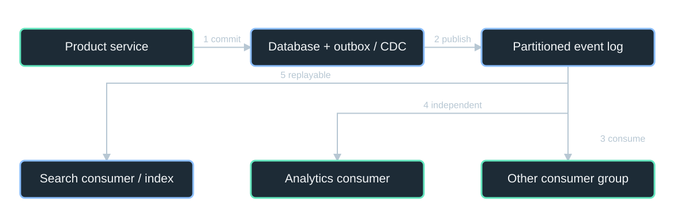

**Diagram scope:** LinkedIn-backed pattern; exact consumers and outbox are teaching choices. Each consumer group has its own progress and recovery.

**Text equivalent:**
- Product service -> Database + outbox / CDC: 1 commit.
- Database + outbox / CDC -> Partitioned event log: 2 publish.
- Partitioned event log -> Other consumer group: 3 consume.
- Partitioned event log -> Analytics consumer: 4 independent.
- Partitioned event log -> Search consumer / index: 5 replayable.

### Write side

Commit authoritative data and a durable publication intent; a relay or CDC stream publishes the event.

### Read/processing side

Separate consumer groups update search, analytics and other views; each tracks its own offset.

### Instructor explanation and discussion

This diagram is a teaching reconstruction of the shared-backbone pattern, not a LinkedIn system inventory. The outbox is a reliability recommendation in the teaching model, not an undocumented assertion that this 2015 deployment used that exact table. Brokers and consumers belong on private networks with authentication, topic authorization, encrypted transport and quotas. Partitioning determines ordering and parallelism. A poison event needs quarantine, diagnostics and controlled replay. A shared broker is still shared infrastructure; it requires replication, capacity planning and monitoring. The original source explains reliability work in cross-datacenter transfer: do not consider an event consumed before it has safely reached the destination.

**Sources:** [S3: LinkedIn: Improving and Advancing Kafka](https://www.engineering.linkedin.com/apache-kafka/how-we_re-improving-and-advancing-kafka-linkedin).

---

## 20. Walk a profile change through the log

**04 Event-driven architecture / TRACE | 00:53-00:57 | 4 min**

> The authoritative update happens once; downstream availability can differ.

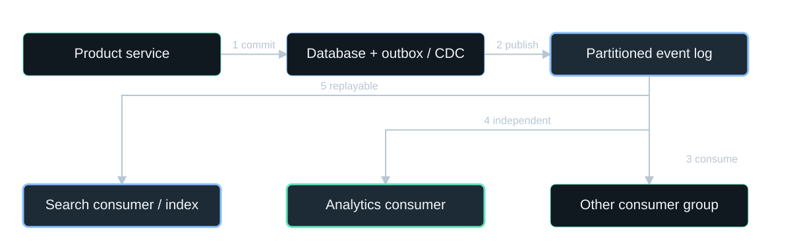

**Diagram scope:** LinkedIn-backed pattern; exact consumers and outbox are teaching choices. Each consumer group has its own progress and recovery.

**Text equivalent:**
- Product service -> Database + outbox / CDC: 1 commit.
- Database + outbox / CDC -> Partitioned event log: 2 publish.
- Partitioned event log -> Other consumer group: 3 consume.
- Partitioned event log -> Analytics consumer: 4 independent.
- Partitioned event log -> Search consumer / index: 5 replayable.

**Highlighted:** Partitioned event log, Search consumer / index, Analytics consumer.

### Normal flow

Commit profile v42 -> publish event E42 -> update search and analytics independently.

### Failure flow

Search is down. Its consumer resumes later; analytics continues. Retried E42 must not apply the same effect twice.

### Instructor explanation and discussion

The profile/version identifiers are classroom examples. Trace the producer commit, durable log append, one consumer's offset and the search index update. Ask when the UI can safely say 'profile saved' versus 'search reflects the change'. Use a stable event ID and idempotent/version-aware writes to a projection. Committing an offset before persisting the derived effect can lose work; persisting the effect then crashing before offset commit can cause redelivery. A local transaction or idempotency strategy handles that uncertainty. Show a stale older version arriving after a newer version and explain why blindly overwriting is unsafe. Retention must cover the expected outage/rebuild window.

**Sources:** [S3: LinkedIn: Improving and Advancing Kafka](https://www.engineering.linkedin.com/apache-kafka/how-we_re-improving-and-advancing-kafka-linkedin).

---

## 21. Decoupled timing still needs ownership

**04 Event-driven architecture / WHY / LIMIT | 00:57-01:00 | 3 min**

> Independent consumers can scale and recover separately; consistency becomes visible.

### Why it helps

A slow indexer no longer blocks every producer. Retained events enable replay and new consumers.

### What it costs

Lag, duplicates, schema evolution, retention, privacy deletion and operational backpressure must be designed.

### Instructor explanation and discussion

S3's quotas and data-transfer improvements show that adding Kafka does not make capacity or durability automatic. State the difference between at-least-once delivery and exactly-once business effects across external systems. Explain why raw events and read models need ownership and retention policies. Ask students whether a transaction receipt should wait for a marketing analytics job; usually not. Ask whether a bank balance may be stale in the same way as a search result; usually the consistency requirements differ. This sets up CQRS, which separates the models used to write and to read rather than merely the communication style.

**Sources:** [S3: LinkedIn: Improving and Advancing Kafka](https://www.engineering.linkedin.com/apache-kafka/how-we_re-improving-and-advancing-kafka-linkedin).

---

## 22. Break - return at minute 70

**Break / BREAK | 01:00-01:10 | 10 min**

> Next: CQRS, with a complete Netflix Tudum before-and-after case.

### Question to keep in mind

If an edit is saved immediately, why might the editor still see the old page?

### Instructor explanation and discussion

Take a full ten-minute break. The next chapter spends thirty minutes on one pattern rather than quickly naming many unrelated technologies.

---

## 23. CQRS: different models for changing and reading data

**05 CQRS / DEFINE | 01:10-01:13 | 3 min**

> Command Query Responsibility Segregation separates the update model from the query model.

### Problem it solves

One model is trying to enforce complex updates and serve very different, high-volume reads.

### Mechanism

Commands validate changes; projections build query-shaped data. Reads use that model rather than reconstructing it on every request.

### Instructor explanation and discussion

Ground the definition in S4. CQRS is not just 'use a read replica' and not simply 'use Kafka'. It separates conceptual responsibilities and models. It can be implemented with one database and separate interfaces, or separate stores with asynchronous propagation. Event sourcing is optional: the write model may store current state, not a permanent event history. With separate asynchronous projections, eventual consistency is a consequence to manage, not an automatic benefit. Give an example of a command such as PublishArticle and a query such as GetHomepage. They may have different permissions, rules and output shapes.

**Sources:** [S4: Martin Fowler: CQRS](https://martinfowler.com/bliki/CQRS.html).

---

## 24. Netflix Tudum had two very different users

**05 CQRS / REAL PROBLEM | 01:13-01:16 | 3 min**

> Editors manage rich content history; visitors need a fast, published page.

### Editors need a write model

Drafts, revisions, internal comments, asset IDs, scheduling settings and validation.

### Visitors need a query model

Current published content, resolved image URLs, movie titles, cast names and page-ready structure.

### Instructor explanation and discussion

S5 is the 2025 Netflix author report; retrieval was through its attributed republication S5R because the original host returned HTTP 403. The reported initial design was considered in late 2021. Present the actual motivation before discussing the later delay: write and read use cases differed enough to benefit from different representations and scaling. For example, an internal asset ID is useful in a CMS, while a rendered page needs a delivery URL. Internal comments must never be copied into a public projection. This is a much more precise problem than saying that CQRS fixes slow global reconciliation. The product is Tudum, Netflix's fan-content website, not the entire Netflix streaming platform.

**Sources:** [S5: Netflix Tudum: CQRS with Kafka to CQRS with RAW Hollow](https://netflixtechblog.com/netflix-tudum-architecture-from-cqrs-with-kafka-to-cqrs-with-raw-hollow-86d141b72e52); [S5R: Attributed republication of the Netflix Tudum article](https://www.blogpivot.app/blog/1/575/netflix-tudum-architecture-from-cqrs-with-kafka-to-cqrs-with-raw-hollow).

---

## 25. Tudum: CMS to read-optimized pages

**05 CQRS / IMPLEMENT | 01:16-01:20 | 4 min**

> Separate models were connected by an ingestion and distribution pipeline.

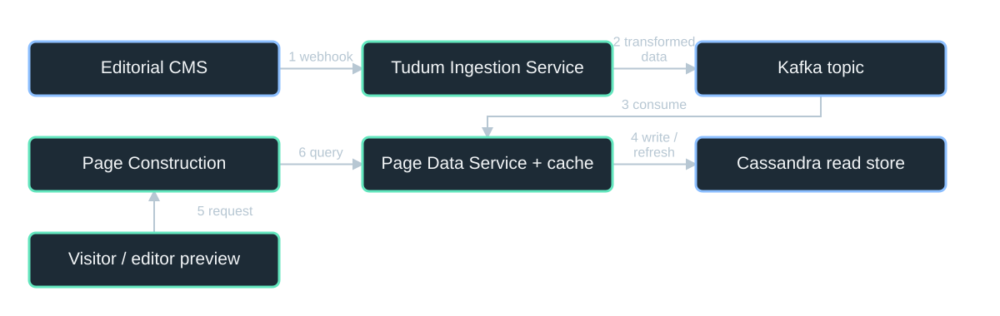

**Diagram scope:** Simplified reported Tudum architecture. The near cache sits inside Page Data Service; its refresh can lag the CMS write.

**Text equivalent:**
- Editorial CMS -> Tudum Ingestion Service: 1 webhook.
- Tudum Ingestion Service -> Kafka topic: 2 transformed data.
- Kafka topic -> Page Data Service + cache: 3 consume.
- Page Data Service + cache -> Cassandra read store: 4 write / refresh.
- Visitor / editor preview -> Page Construction: 5 request.
- Page Construction -> Page Data Service + cache: 6 query.

### Transform the model

Ingestion queried CMS data, applied templates, validated assets and resolved public-facing content.

### Publish the query view

Kafka carried content to a Page Data Service consumer, which stored it in Cassandra and served page-building queries.

### Instructor explanation and discussion

This is a simplified reconstruction of the reported data path. The Page Data Service contains consumer/API responsibilities and a near cache; these are combined in one box to keep the figure readable. The CMS remains the editorial source; Cassandra stores transformed query-side content. The Page Construction Service reads that content to assemble the page. A concrete illustrative transform is {assetId: A17, movieId: M4, internalNote: ...} becoming {imageUrl: https://cdn/... , title: ..., synopsis: ...}; internalNote is omitted. Do not confuse an example JSON shape with the actual production schema. A CDN URL points to a separate media/asset path, not through the CMS for every image.

**Sources:** [S5: Netflix Tudum: CQRS with Kafka to CQRS with RAW Hollow](https://netflixtechblog.com/netflix-tudum-architecture-from-cqrs-with-kafka-to-cqrs-with-raw-hollow-86d141b72e52); [S5R: Attributed republication of the Netflix Tudum article](https://www.blogpivot.app/blog/1/575/netflix-tudum-architecture-from-cqrs-with-kafka-to-cqrs-with-raw-hollow).

---

## 26. Publish is accepted. Is it visible yet?

**05 CQRS / TRACE A WRITE | 01:20-01:24 | 4 min**

> Saving in the CMS and becoming visible in every read model are different milestones.

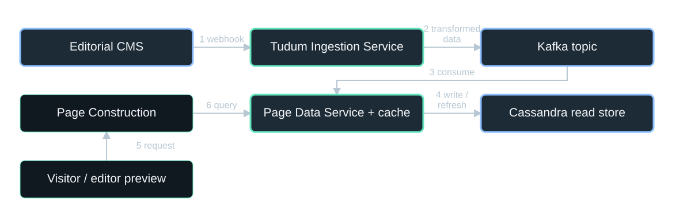

**Diagram scope:** Simplified reported Tudum architecture. The near cache sits inside Page Data Service; its refresh can lag the CMS write.

**Text equivalent:**
- Editorial CMS -> Tudum Ingestion Service: 1 webhook.
- Tudum Ingestion Service -> Kafka topic: 2 transformed data.
- Kafka topic -> Page Data Service + cache: 3 consume.
- Page Data Service + cache -> Cassandra read store: 4 write / refresh.
- Visitor / editor preview -> Page Construction: 5 request.
- Page Construction -> Page Data Service + cache: 6 query.

**Highlighted:** Editorial CMS, Tudum Ingestion Service, Kafka topic, Page Data Service + cache, Cassandra read store.

### 1 | Source and transformation

After the CMS save, a webhook triggers fetching, validation and transformation.

### 2 -> 3 -> 4

Publish to Kafka -> consume -> store the transformed page. A near-cache refresh still remains.

### Instructor explanation and discussion

Walk the reported five-stage process slowly, highlighting one handoff at a time. A successful CMS API response acknowledges the CMS write, not completion of the later Kafka consumer and cache refresh. This is the mechanism behind eventual consistency in this particular implementation. Ask students which stage they would timestamp to explain a stale preview: source commit, webhook receipt, ingestion finish, consumer commit and cache-visible version. Discuss recommended defenses without pretending the source documents every one: idempotency, versioning, retry visibility, webhook validation and a dead-letter/replay process. A retried webhook must not accidentally roll a projection back to an older version.

**Sources:** [S5: Netflix Tudum: CQRS with Kafka to CQRS with RAW Hollow](https://netflixtechblog.com/netflix-tudum-architecture-from-cqrs-with-kafka-to-cqrs-with-raw-hollow-86d141b72e52); [S5R: Attributed republication of the Netflix Tudum article](https://www.blogpivot.app/blog/1/575/netflix-tudum-architecture-from-cqrs-with-kafka-to-cqrs-with-raw-hollow).

---

## 27. Why is Tudum's read path cheaper?

**05 CQRS / TRACE A READ | 01:24-01:28 | 4 min**

> The visitor reads a page-ready representation, not the entire editorial model.

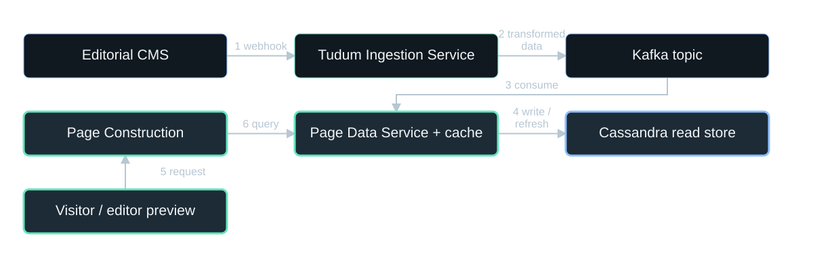

**Diagram scope:** Simplified reported Tudum architecture. The near cache sits inside Page Data Service; its refresh can lag the CMS write.

**Text equivalent:**
- Editorial CMS -> Tudum Ingestion Service: 1 webhook.
- Tudum Ingestion Service -> Kafka topic: 2 transformed data.
- Kafka topic -> Page Data Service + cache: 3 consume.
- Page Data Service + cache -> Cassandra read store: 4 write / refresh.
- Visitor / editor preview -> Page Construction: 5 request.
- Page Construction -> Page Data Service + cache: 6 query.

**Highlighted:** Visitor / editor preview, Page Construction, Page Data Service + cache, Cassandra read store.

### Read path

Browser -> Page Construction -> Page Data Service / near cache -> transformed content.

### Work removed from the request

CMS joins, editorial revision handling and asset resolution were performed during ingestion instead.

### Instructor explanation and discussion

Trace the HTTP read separately from the write. Query-side scaling can be independent of editorial load; visitors need not compete directly with draft editing transactions. The benefit comes from eager transformation and an appropriate query shape, not from naming the architecture CQRS. Show that a near cache hit avoids an external database read, while a cold/missing cache can still cause remote work. A production deployment also has DNS, TLS, WAF, identity checks and restricted origin/private backend paths. Public published pages can be cached only under an appropriate cache policy; authenticated draft previews must not leak into a public CDN cache. CQRS does not remove any of these security requirements.

**Sources:** [S5: Netflix Tudum: CQRS with Kafka to CQRS with RAW Hollow](https://netflixtechblog.com/netflix-tudum-architecture-from-cqrs-with-kafka-to-cqrs-with-raw-hollow-86d141b72e52); [S5R: Attributed republication of the Netflix Tudum article](https://www.blogpivot.app/blog/1/575/netflix-tudum-architecture-from-cqrs-with-kafka-to-cqrs-with-raw-hollow).

---

## 28. The new problem: previews were too stale

**05 CQRS / DIAGNOSE | 01:28-01:32 | 4 min**

> The architecture improved query serving, but its near-cache refresh delayed visible edits.

### Reported cause

The Page Data Service near cache refreshed in the background. More content increased the refresh delay.

### Why this matters

CQRS separated the models; it did not guarantee immediate propagation or read-your-writes.

### Instructor explanation and discussion

The Netflix account explains a refresh example: 60 keys with a 60-second refresh interval implies one key refreshed per second. It says growing content made the delay worse, and describes the overall improvement later as seconds instead of minutes. Do not turn that illustrative refresh example into a universal implementation formula or claim every update took exactly sixty seconds. Ask students to separate query response latency from write-to-visible latency. A page may render quickly and still show old data. Increasing API replicas may multiply caches and fail to solve the refresh bottleneck. This is the important correction to the idea that CQRS itself fixes reconciliation across globally deployed replicas.

**Sources:** [S5: Netflix Tudum: CQRS with Kafka to CQRS with RAW Hollow](https://netflixtechblog.com/netflix-tudum-architecture-from-cqrs-with-kafka-to-cqrs-with-raw-hollow-86d141b72e52); [S5R: Attributed republication of the Netflix Tudum article](https://www.blogpivot.app/blog/1/575/netflix-tudum-architecture-from-cqrs-with-kafka-to-cqrs-with-raw-hollow).

---

## 29. Keep CQRS; simplify data distribution

**05 CQRS / REVISE IMPLEMENTATION | 01:32-01:35 | 3 min**

> Tudum replaced its Kafka / Page Data Service / key-value path with RAW Hollow.

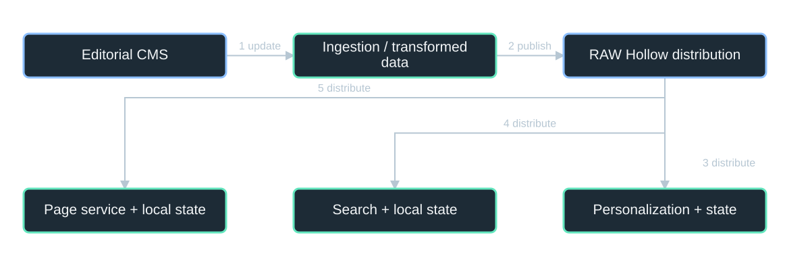

**Diagram scope:** Reported replacement, simplified: query services read embedded state. Not a complete diagram of RAW Hollow's internal replication protocol.

**Text equivalent:**
- Editorial CMS -> Ingestion / transformed data: 1 update.
- Ingestion / transformed data -> RAW Hollow distribution: 2 publish.
- RAW Hollow distribution -> Personalization + state: 3 distribute.
- RAW Hollow distribution -> Search + local state: 4 distribute.
- RAW Hollow distribution -> Page service + local state: 5 distribute.

### New mechanism

Compressed in-memory state is embedded in read-path services, avoiding repeated request-time I/O.

### Freshness choice

RAW Hollow offers eventual consistency by default and request-level read-after-write behavior when needed.

### Instructor explanation and discussion

The Netflix article is titled 'from CQRS with Kafka to CQRS with RAW Hollow'; do not say CQRS was abandoned. The implementation and distribution mechanism changed. The diagram is a schematic of the reported replacement, not a claim about every internal RAW Hollow protocol or replica. It shows ingestion/publishing and local state in page construction, search and personalization. Do not conflate ordinary read-only Hollow documentation with every RAW Hollow guarantee. The source reports the read-after-write option; a generic way to reason about it is that a preview requires at least the version it just wrote, otherwise it waits, routes or fails explicitly. That version-barrier illustration is a teaching model, not an undocumented exact API signature.

**Sources:** [S5: Netflix Tudum: CQRS with Kafka to CQRS with RAW Hollow](https://netflixtechblog.com/netflix-tudum-architecture-from-cqrs-with-kafka-to-cqrs-with-raw-hollow-86d141b72e52); [S5R: Attributed republication of the Netflix Tudum article](https://www.blogpivot.app/blog/1/575/netflix-tudum-architecture-from-cqrs-with-kafka-to-cqrs-with-raw-hollow).

---

## 30. Tudum: faster previews and less request-time I/O

**05 CQRS / REPORTED RESULT | 01:35-01:38 | 3 min**

> The reported homepage construction time fell from about 1.4 seconds to about 0.4 seconds.

### Why the result followed

The critical read path stopped repeatedly calling a remote data service; local state removed round trips.

### Where the design fit

The report says three years of unhydrated data occupied about 130 MB compressed. A bounded dataset made local copies practical.

**~1.4 s -> ~0.4 s** - Reported homepage construction time; not full page-load latency.

### Instructor explanation and discussion

These are reported case metrics, not independently measured benchmarks. S5 controls the comparison for TLS, authentication, logging and WAF filtering; the metric is homepage construction time, not total worldwide browser page-load time. The article reports editors previewing changes in seconds rather than minutes and compressed unhydrated data at about one quarter of its uncompressed Iceberg size. Do not generalize to arbitrary terabyte-scale mutable transactional data. Embedded state couples consumers to schemas, increases per-instance memory needs and requires update/recovery behavior. Explain that a roughly 71% reduction is arithmetic from rounded timings, not a separately measured precision claim; keep the original approximate values on the slide.

**Sources:** [S5: Netflix Tudum: CQRS with Kafka to CQRS with RAW Hollow](https://netflixtechblog.com/netflix-tudum-architecture-from-cqrs-with-kafka-to-cqrs-with-raw-hollow-86d141b72e52); [S5R: Attributed republication of the Netflix Tudum article](https://www.blogpivot.app/blog/1/575/netflix-tudum-architecture-from-cqrs-with-kafka-to-cqrs-with-raw-hollow).

---

## 31. CQRS is a model decision - not a replication protocol

**05 CQRS / LIMIT + CHECK | 01:38-01:40 | 2 min**

> It can make reads simpler and independently scalable while making freshness harder.

### Use it when

Read and update models genuinely diverge, and the benefits justify projection/recovery complexity.

### Check your reasoning

For slow global updates, locate the lag first: transport, projection, replication or cache refresh? Then choose that mechanism's remedy.

### Instructor explanation and discussion

Ask students to answer in one sentence: what problem did CQRS solve for Tudum, and what problem did RAW Hollow address later? Expected: CQRS separated rich editorial updates from read-optimized visitor content; the later implementation addressed propagation/cache-refresh delay and request-time I/O. Strong consistency, multi-writer conflict resolution, cross-region failover and event sourcing are separate design decisions. A simple CRUD application with similar read/write shapes may not need CQRS. Do not advertise a new datastore as a universal remedy; choose it only if dataset size, update rate and required guarantees fit.

**Sources:** [S4: Martin Fowler: CQRS](https://martinfowler.com/bliki/CQRS.html); [S5: Netflix Tudum: CQRS with Kafka to CQRS with RAW Hollow](https://netflixtechblog.com/netflix-tudum-architecture-from-cqrs-with-kafka-to-cqrs-with-raw-hollow-86d141b72e52); [S5R: Attributed republication of the Netflix Tudum article](https://www.blogpivot.app/blog/1/575/netflix-tudum-architecture-from-cqrs-with-kafka-to-cqrs-with-raw-hollow).

---

## 32. Cache hierarchy: avoid repeated storage I/O

**06 Distributed cache hierarchy / DEFINE | 01:40-01:43 | 3 min**

> Several cache tiers share a data-access contract and coordinate with the source of truth.

### Problem it solves

A personalized, read-heavy workload overwhelms storage or makes every request too expensive.

### Mechanism

Answer hot reads in memory; route misses toward durable storage; control writes and invalidation through a shared access layer.

### Instructor explanation and discussion

Distinguish cache-aside from write-through access. In cache-aside, application code checks and fills the cache; in the TAO case, a service coordinates the hierarchy and writes. The cache is another copy of state, not the source of truth by default. A hierarchy adds capacity and protection but also freshness and failure complexity. Sharding partitions the durable dataset; caching replicates selected data for faster access. These are complementary mechanisms, not interchangeable names. Explain a hot key: hashing many keys evenly does not stop millions of requests for one celebrity post.

---

## 33. Facebook: graph reads were costly

**06 Distributed cache hierarchy / REAL PROBLEM | 01:43-01:46 | 3 min**

> Product engineers had to coordinate memcache and MySQL themselves.

### Workload problem

Pages needed many graph facts quickly; celebrity content caused sharp hotspots.

### Engineering problem

Cache fills, invalidation and relational-to-key/value mapping leaked into product code, causing inconsistency and complexity.

### Instructor explanation and discussion

S6 is Facebook's 2013 TAO engineering account. Use concrete graph questions: does user U like post P, and what are the most recent comments on P? The source describes read-dominated, highly customized output and mismatch with ordinary database block caching. Memcache improved efficiency, but it did not automatically fill itself or maintain consistency. Small association-list changes could invalidate large entries; clients sometimes transferred whole lists unnecessarily. The product problem was both runtime cost and developer complexity. Avoid claiming TAO is Facebook's full feed-ranking system or its exact current architecture.

**Sources:** [S6: Meta: TAO - The power of the graph](https://engineering.fb.com/2013/06/25/core-infra/tao-the-power-of-the-graph/).

---

## 34. TAO put graph operations behind one access layer

**06 Distributed cache hierarchy / IMPLEMENT + READ | 01:46-01:50 | 4 min**

> Application -> follower cache -> leader cache -> MySQL shard.

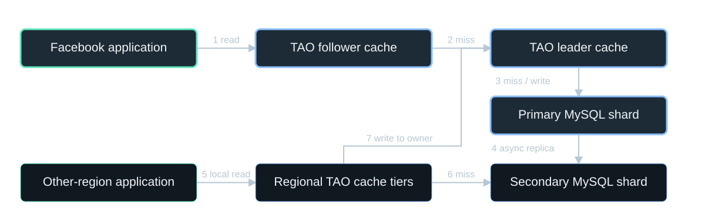

**Diagram scope:** Historical TAO (2013), simplified. The lower regional cache tiers are collapsed; every shard has a primary region.

**Text equivalent:**
- Facebook application -> TAO follower cache: 1 read.
- TAO follower cache -> TAO leader cache: 2 miss.
- TAO leader cache -> Primary MySQL shard: 3 miss / write.
- Primary MySQL shard -> Secondary MySQL shard: 4 async replica.
- Other-region application -> Regional TAO cache tiers: 5 local read.
- Regional TAO cache tiers -> Secondary MySQL shard: 6 miss.
- Regional TAO cache tiers -> TAO leader cache: 7 write to owner.

**Highlighted:** Facebook application, TAO follower cache, TAO leader cache, Primary MySQL shard.

### Trace a read

A follower hit returns quickly. A miss goes to the leader; a further miss reaches durable MySQL.

### Why this helps

Product code uses object/association operations; cache tiers and storage can scale separately.

### Instructor explanation and discussion

This is a simplified historical source-based reconstruction. TAO represents typed objects and associations and exposes point, range and count operations. It deliberately does not act as an arbitrary graph-query engine. Show the top region first; on a hit, later steps disappear from the critical path. On a miss, the leader supplies an additional cache/protection layer before MySQL. Objects and associations are partitioned into shards, and related data can be collocated to reduce communication. The same graph API hides the dual-store chores from product engineers. Network services are private and authenticated; the topology does not imply that knowing an object ID grants permission to view it.

**Sources:** [S6: Meta: TAO - The power of the graph](https://engineering.fb.com/2013/06/25/core-infra/tao-the-power-of-the-graph/).

---

## 35. A like written in one region has to reach other copies

**06 Distributed cache hierarchy / TRACE A GLOBAL WRITE | 01:50-01:54 | 4 min**

> In the documented TAO design, each shard has one primary region.

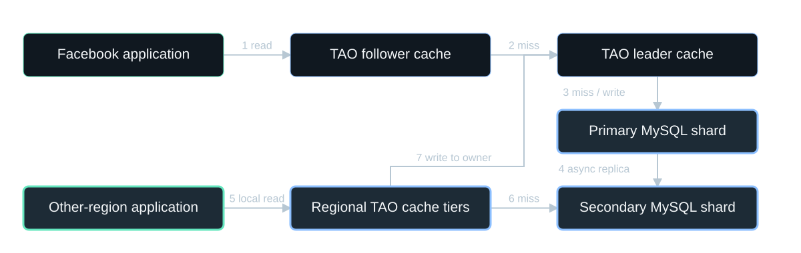

**Diagram scope:** Historical TAO (2013), simplified. The lower regional cache tiers are collapsed; every shard has a primary region.

**Text equivalent:**
- Facebook application -> TAO follower cache: 1 read.
- TAO follower cache -> TAO leader cache: 2 miss.
- TAO leader cache -> Primary MySQL shard: 3 miss / write.
- Primary MySQL shard -> Secondary MySQL shard: 4 async replica.
- Other-region application -> Regional TAO cache tiers: 5 local read.
- Regional TAO cache tiers -> Secondary MySQL shard: 6 miss.
- Regional TAO cache tiers -> TAO leader cache: 7 write to owner.

**Highlighted:** Other-region application, Regional TAO cache tiers, Primary MySQL shard, Secondary MySQL shard.

### Write path

Followers forward to leaders; a secondary region forwards a write to that shard's primary region.

### Propagation

The durable write updates caches on its return path; MySQL replication carries state to secondary regions.

### Instructor explanation and discussion

Trace a like created from the lower region. The secondary store cannot independently accept the update for this shard; it forwards to the primary owner. Explain that different shards may have different primary regions, so 'one primary per shard' is not 'one write region for all Facebook data'. Replication is asynchronous and eventual consistency is the default in the 2013 account. A successful write is not proof every remote reader already sees the new like. A primary switch needs safe ownership and fencing; DNS changes alone cannot make two independent writers consistent. This provides the concrete global-data example: the replication/ownership protocol handles cross-region writes, not the CQRS label.

**Sources:** [S6: Meta: TAO - The power of the graph](https://engineering.fb.com/2013/06/25/core-infra/tao-the-power-of-the-graph/).

---

## 36. TAO centralized graph-read coordination

**06 Distributed cache hierarchy / WHY / RESULT | 01:54-01:57 | 3 min**

> The interface matched the product's graph access patterns.

### Reported mechanisms

Point/range/count operations, two cache tiers, write coordination and independent cache/storage scaling.

### Concrete benefit

A '50 most recent comments' request does not need to fetch and manipulate an entire association list in application code.

### Instructor explanation and discussion

The source reports large production scale and the API's broad adoption, but the lecture does not invent a before/after latency benchmark. Focus on the causal mechanism: less transferred data, more cache hits for the workload, and shared implementation of consistency chores. Explain that a cache tier can protect storage during outages or cold starts only within its capacity and available cached data. A stale cached permission or deleted post is not acceptable just because a like count can be eventually consistent. Security-sensitive checks need requirements stronger than a generic cache TTL.

**Sources:** [S6: Meta: TAO - The power of the graph](https://engineering.fb.com/2013/06/25/core-infra/tao-the-power-of-the-graph/).

---

## 37. When the hottest cache entry disappears

**06 Distributed cache hierarchy / FAILURE + DISCUSS | 01:57-02:00 | 3 min**

> A cache miss can become a thundering herd.

### Implementation defenses

Coalesce identical in-flight reads; stagger refreshes; bound storage concurrency; preserve safe stale data where allowed.

### Discussion

Would you use the same freshness policy for a like count, a private-post revocation and an inventory reservation?

### Instructor explanation and discussion

These defenses are general engineering recommendations; do not attribute an exact implementation of every technique to the TAO article. Expected answer: no, semantics differ. Like counts can often lag; privacy revocations require timely enforcement at serving; stock must be protected by the owning transaction/concurrency mechanism. Explain that TTL alone does not prevent stale refill races: a reader can fetch old data before a write, then repopulate the cache after invalidation. Versions or fences can prevent regression. The optional Discord appendix shows a separately documented request-coalescing implementation with a precise real-world traffic scenario.

---

## 38. Edge delivery: put reusable bytes near the reader

**07 Edge delivery / CDN / DEFINE | 02:00-02:03 | 3 min**

> A CDN serves content from geographically distributed delivery locations.

### Problem it solves

Long network paths, constrained interconnects and origin bandwidth make large global downloads slow or costly.

### Mechanism

Replicate or preposition content, steer requests to an appropriate location and keep bulk delivery off application servers.

### Instructor explanation and discussion

A CDN is a delivery pattern, not a substitute for application services or consistency policy. Separate the control plane, which authorizes playback and provides metadata, from the data plane, which transfers media bytes. Content may be fetched on demand, prepositioned, or both. DNS naming, application steering and BGP packet routing are different layers. HTTP caching policy and content-addressed/versioned URLs make immutable content easier to distribute. Dynamic, personalized or protected content needs appropriate authorization and cache keys.

---

## 39. Netflix: video needs a separate data path

**07 Edge delivery / CDN / REAL PROBLEM | 02:03-02:06 | 3 min**

> A successful Play request is tiny compared with the stream it enables.

### The documented goal

Open Connect localizes Netflix traffic and reduces traffic carried over transit providers.

### Why locality matters

Serving popular video within a participating ISP reduces distant network demand and improves the viewer delivery path.

### Instructor explanation and discussion

S7 documents the program's objectives and components; do not invent a single incident that caused Open Connect or a latency percentage absent from the source. Relate the problem to a familiar user action: pressing Play starts many segment requests over time. An authorization API returning a small manifest is a different workload from sustained video egress. A hypothetical 100,000 viewers at 5 Mb/s requires 500 Gb/s aggregate egress before overhead. The arithmetic is a classroom capacity sketch, not a Netflix traffic measurement. Adding API replicas would not by itself provide that network capacity.

**Sources:** [S7: Netflix Open Connect](https://openconnect.netflix.com/en/).

---

## 40. Open Connect: appliances, peering and content fill

**07 Edge delivery / CDN / IMPLEMENT | 02:06-02:10 | 4 min**

> Netflix works with ISP partners to deliver from nearby appliances.

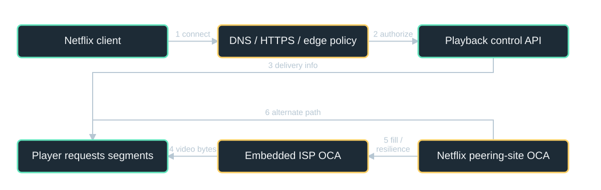

**Diagram scope:** Open Connect delivery model with conceptual control path. BGP / peering determine reachability; another OCA can serve during failures.

**Text equivalent:**
- Netflix client -> DNS / HTTPS / edge policy: 1 connect.
- DNS / HTTPS / edge policy -> Playback control API: 2 authorize.
- Playback control API -> Player requests segments: 3 delivery info.
- Embedded ISP OCA -> Player requests segments: 4 video bytes.
- Netflix peering-site OCA -> Embedded ISP OCA: 5 fill / resilience.
- Netflix peering-site OCA -> Player requests segments: 6 alternate path.

### Documented components

Embedded Open Connect Appliances in qualifying ISP networks, Netflix OCA sites and settlement-free interconnection.

### Network implementation

BGP sessions and peering influence reachability; planned fills preposition content. Not every ISP has embedded appliances.

### Instructor explanation and discussion

This is a simplified source-based delivery diagram with conceptual playback-control context. The source describes embedded OCAs, private or IXP-based interconnection and nightly fills/updates. Some partners use peering without an embedded OCA. Do not present Open Connect as a generic origin-pull cache that must fetch every first request from object storage. The upper control path represents naming, ingress and authorization concepts, not a disclosed inventory of Netflix backend services. The lower path shows media delivery; firewall/allowlist and origin restrictions should protect management and content-fill access. Interconnection and TLS address different problems.

**Sources:** [S7: Netflix Open Connect](https://openconnect.netflix.com/en/).

---

## 41. Walk pressing Play, then losing the local appliance

**07 Edge delivery / CDN / TRACE | 02:10-02:14 | 4 min**

> The player can keep the API path separate from the media path.

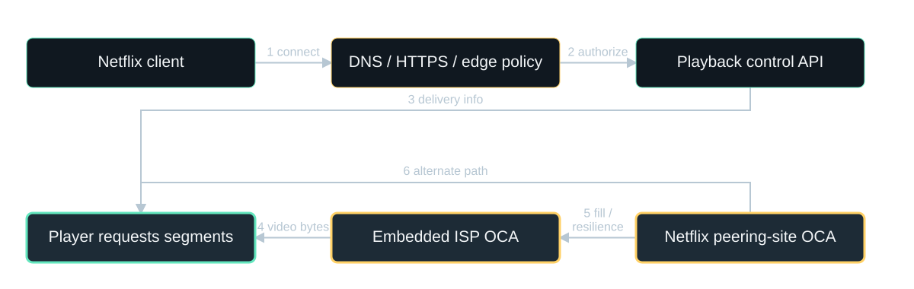

**Diagram scope:** Open Connect delivery model with conceptual control path. BGP / peering determine reachability; another OCA can serve during failures.

**Text equivalent:**
- Netflix client -> DNS / HTTPS / edge policy: 1 connect.
- DNS / HTTPS / edge policy -> Playback control API: 2 authorize.
- Playback control API -> Player requests segments: 3 delivery info.
- Embedded ISP OCA -> Player requests segments: 4 video bytes.
- Netflix peering-site OCA -> Embedded ISP OCA: 5 fill / resilience.
- Netflix peering-site OCA -> Player requests segments: 6 alternate path.

**Highlighted:** Player requests segments, Embedded ISP OCA, Netflix peering-site OCA.

### Normal flow

Resolve/connect -> authorize playback -> receive delivery information -> request media from a suitable OCA.

### Failure flow

If an embedded appliance fails, another embedded site or Netflix's peering-site appliances can serve the traffic.

### Instructor explanation and discussion

S7 explicitly shows failover from one embedded appliance to another, and then to Netflix IX appliances when both embedded sites are unavailable. The exact client retry and selection protocol is abstracted here. Discuss how already-open sessions, cached DNS answers, alternate capacity and retries affect observed recovery. A healthy endpoint must also hold or be able to serve the required content. An authorized media request may use signed URLs/cookies and possibly DRM/license services; these are general streaming controls, not exact mechanisms asserted by the cited page. Prevent direct unauthenticated origin bypass and avoid leaking tokens in logs.

**Sources:** [S7: Netflix Open Connect](https://openconnect.netflix.com/en/).

---

## 42. Locality and adaptation are different

**07 Edge delivery / CDN / WHY / DETAILS | 02:14-02:17 | 3 min**

> The CDN shortens delivery paths; adaptive bitrate matches the available connection.

### Delivery efficiency

Popular bytes are reused near viewers; API capacity is reserved for business/control requests.

### Player resilience

Multiple encoded renditions let the player choose subsequent segments based on throughput and buffer health.

### Instructor explanation and discussion

Adaptive bitrate here is general streaming architecture, not a new factual claim from the Open Connect page. Explain manifest, segment and rendition: a manifest describes variants/segments; the player fetches chunks and may switch rendition at compatible boundaries. At 5 Mb/s, a four-second segment is about 2.5 MB before overhead. A local CDN cannot repair a failing household Wi-Fi link, and ABR cannot create bandwidth that does not exist. Track startup time, rebuffering and delivered quality rather than only HTTP success rate. Transcoding and immutable asset publication are asynchronous preparation stages, separate from the live segment-serving path.

**Sources:** [S7: Netflix Open Connect](https://openconnect.netflix.com/en/).

---

## 43. Local traffic, distributed operations

**07 Edge delivery / CDN / RESULT + LIMIT | 02:17-02:20 | 3 min**

> Open Connect trades centralized delivery pressure for appliance, routing and capacity management.

### Why the pattern fits

Many viewers request reusable video bytes, and demand can be anticipated or absorbed at multiple delivery locations.

### When it is insufficient

Private authorization, entitlement, catalog updates, fill capacity and regional failover still require independent designs.

### Instructor explanation and discussion

The official source supports traffic localization and reduced transit demand; it does not establish a universal percentage cost or latency improvement. Ask students whether a CDN fixes an overloaded recommendation database. It does not; the workloads differ. A global launch can simultaneously stress control APIs, license issuance and media capacity even if the media is already positioned. Versioned immutable URLs ease consistency, but revoking private content can require token expiry, purging and fresh authorization checks. Backups and regional data recovery remain necessary for the control plane.

**Sources:** [S7: Netflix Open Connect](https://openconnect.netflix.com/en/).

---

## 44. Break - return at minute 150

**Break / BREAK | 02:20-02:30 | 10 min**

> Final pattern: learning from feedback quickly enough to change the next recommendation.

### Question to keep in mind

If user interests change in minutes, what is lost by training the model only overnight?

### Instructor explanation and discussion

Take ten minutes. The final twenty-minute case distinguishes TikTok's publicly described behavior from the documented ByteDance/BytePlus system; do not merge them into an invented TikTok blueprint.

---

## 45. Online recommendation: close the feedback loop

**08 Online recommendation pipeline / DEFINE | 02:30-02:33 | 3 min**

> Serving, event processing and training cooperate so recent behavior can influence later predictions.

### Problem it solves

User interests and available items change faster than a slow batch-training cycle can react.

### Mechanism

Log features/outcomes, join training examples, update parameters and safely synchronize the serving model.

### Instructor explanation and discussion

This is an application/dataflow pattern, not a GoF class pattern. Distinguish online inference from online training: every recommendation service may score live requests, but its model may still be trained in batches. The pattern discussed here also updates from newly observed feedback. A single tap does not necessarily trigger an immediate full-model retraining. The implementation must account for delayed outcomes, changing IDs, throughput, memory, feature consistency and evaluation. The benefits require a real sensitivity to freshness; a static catalog with little behavioral signal may not justify this architecture.

---

## 46. TikTok makes the freshness problem visible

**08 Online recommendation pipeline / REAL PROBLEM | 02:33-02:36 | 3 min**

> A For You feed changes as people watch, skip, like and follow.

### Documented TikTok behavior

Interactions, video information and device/account settings influence ranked recommendations.

### Documented engineering case

ByteDance's 2022 Monolith paper addresses dynamic sparse features and concept drift; it reports deployment in BytePlus Recommend.

### Instructor explanation and discussion

Use S8 to describe the familiar product behavior. Then explicitly switch to S9 for the engineering implementation: the paper names BytePlus Recommend, not a complete TikTok production stack. 'Monolith' is the system's proper name and is unrelated to the first chapter's deployment pattern. The paper describes user/item IDs changing over time and the underlying distribution shifting, called concept drift. A stale model may not reflect a user's recent interest. Do not make up a TikTok engagement lift or suggest every short-video platform uses these exact components.

**Sources:** [S8: TikTok: How TikTok recommends videos #ForYou](https://newsroom.tiktok.com/en-us/how-tiktok-recommends-videos-for-you); [S9: Liu et al.: Monolith](https://arxiv.org/html/2209.07663v2).

---

## 47. Monolith: turn events into training data

**08 Online recommendation pipeline / IMPLEMENT | 02:36-02:40 | 4 min**

> Two Kafka inputs are joined before an online worker updates the model.

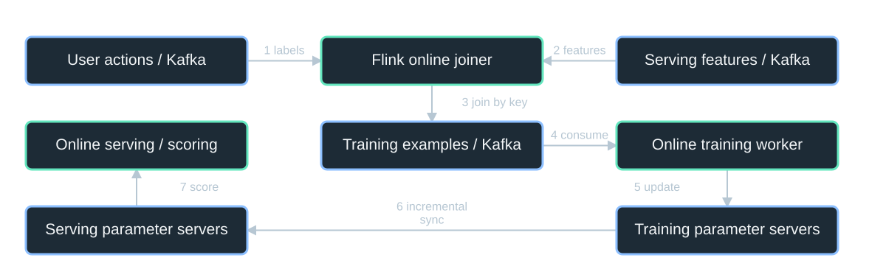

**Diagram scope:** ByteDance Monolith / BytePlus case (2022), simplified. This is not a claimed complete TikTok architecture.

**Text equivalent:**
- User actions / Kafka -> Flink online joiner: 1 labels.
- Serving features / Kafka -> Flink online joiner: 2 features.
- Flink online joiner -> Training examples / Kafka: 3 join by key.
- Training examples / Kafka -> Online training worker: 4 consume.
- Online training worker -> Training parameter servers: 5 update.
- Training parameter servers -> Serving parameter servers: 6 incremental sync.
- Serving parameter servers -> Online serving / scoring: 7 score.

### Inputs and join

One stream carries user actions; another carries features. A Flink online joiner matches them using a unique request key.

### Training and serving

Training workers update training parameter servers; selected parameter changes are synchronized to serving parameter servers.

### Instructor explanation and discussion

This is a simplified reconstruction of S9's streaming engine and worker/parameter-server design. Define a parameter server: a distributed owner of model parameters used and updated by workers. Dense parameters are neural-network weights; sparse parameters include embeddings for feature IDs. The joiner cannot simply pair the next feature with the next click because events can arrive out of order or much later. The source describes in-memory lookup plus on-disk storage for older pending features. The training-example stream can also be dumped for batch training; the diagram omits that side branch to focus on the online loop. These components require private authenticated networks, bounded data retention and access controls over behavioral data.

**Sources:** [S9: Liu et al.: Monolith](https://arxiv.org/html/2209.07663v2).

---

## 48. Walk one watch event back into later predictions

**08 Online recommendation pipeline / TRACE | 02:40-02:44 | 4 min**

> A fresh signal is useful only after it becomes a correctly matched example and reaches serving.

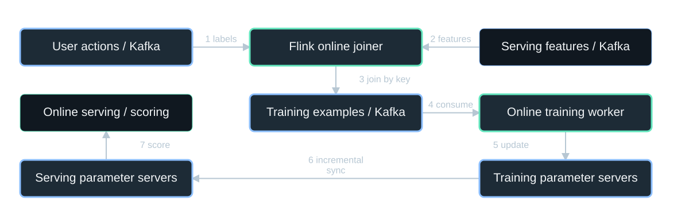

**Diagram scope:** ByteDance Monolith / BytePlus case (2022), simplified. This is not a claimed complete TikTok architecture.

**Text equivalent:**
- User actions / Kafka -> Flink online joiner: 1 labels.
- Serving features / Kafka -> Flink online joiner: 2 features.
- Flink online joiner -> Training examples / Kafka: 3 join by key.
- Training examples / Kafka -> Online training worker: 4 consume.
- Online training worker -> Training parameter servers: 5 update.
- Training parameter servers -> Serving parameter servers: 6 incremental sync.
- Serving parameter servers -> Online serving / scoring: 7 score.

**Highlighted:** User actions / Kafka, Flink online joiner, Training examples / Kafka, Online training worker, Training parameter servers, Serving parameter servers.

### 1 -> 2 -> 3 | Match the streams

Actions and serving features arrive independently; join them by request ID to build a labeled example.

### 4 -> 5 -> 6 -> 7 | Train and serve

Consume the example -> update parameters -> synchronize changes -> score a later request.

### Instructor explanation and discussion

Use a hypothetical request R123 for a video impression. The feature record describes what the model saw at impression time; a later action is joined by key, not by wall-clock adjacency. Explain late labels and why 'no click yet' is not necessarily a final negative. S9 describes minute-level synchronization for touched sparse parameters, with dense parameters updated less frequently. That is not an assertion that every user action changes every served score instantly. The source tracks touched keys to avoid transferring the full multi-terabyte model on every synchronization. Keeping the serving process available during updates is part of the implementation, not an optional optimization.

**Sources:** [S9: Liu et al.: Monolith](https://arxiv.org/html/2209.07663v2).

---

## 49. Why not copy the whole model after every event?

**08 Online recommendation pipeline / WHY / ENGINEERING | 02:44-02:47 | 3 min**

> The paper's solution reduces network and memory work while preserving timely updates.

### Incremental synchronization

Track updated sparse IDs and transmit their changed embeddings rather than the whole parameter set.

### Sparse-state management

Collisionless tables avoid merging unrelated IDs; frequency filtering and expiry limit memory consumption.

### Instructor explanation and discussion

S9 describes a Cuckoo-hash-based sparse parameter table, filtering infrequent IDs and expiring stale ones. Explain why two users sharing an embedding because of a hash collision can hurt representation quality. These mechanisms address different forces: incremental sync addresses update cost, while table design addresses identity representation and memory. The paper reports evaluations favoring collisionless embeddings and more frequent updates; do not claim they guarantee a fixed gain for all datasets. Production deployment also needs feature-version compatibility, model quality monitoring and the ability to roll back or fall back safely.

**Sources:** [S9: Liu et al.: Monolith](https://arxiv.org/html/2209.07663v2).

---

## 50. Fresher learning is not free intelligence

**08 Online recommendation pipeline / RESULT + LIMIT | 02:47-02:50 | 3 min**

> The paper reports better evaluated model quality, with explicit reliability and resource trade-offs.

### Why it helps

The learning loop incorporates recent feedback instead of waiting for the next large batch cycle.

### What it costs

Late labels, biased feedback, privacy obligations, parameter recovery, compute and safety controls remain.

### Instructor explanation and discussion

S9 reports production-scale experiments and a live A/B evaluation, but the lecture does not extract an unsupported product-wide revenue or engagement number. The paper also discusses snapshotting and tolerating some lost recent parameter updates; this is a model-quality/recovery trade-off, not acceptable loss of financial records. Online learning can amplify feedback loops, so evaluate diversity, harmful content exposure and policy compliance rather than only click-through rate. A safe fallback must still enforce current content eligibility. Tie the lesson back to CQRS: read-serving state and update/training state are separated here too, but this alone does not determine the learning algorithm or synchronization guarantee.

**Sources:** [S8: TikTok: How TikTok recommends videos #ForYou](https://newsroom.tiktok.com/en-us/how-tiktok-recommends-videos-for-you); [S9: Liu et al.: Monolith](https://arxiv.org/html/2209.07663v2).

---

## 51. Match the mechanism to the bottleneck

**Synthesis / COMPARE | 02:50-02:53 | 3 min**

> Different patterns change different kinds of work.

### Change and ownership

Monolith simplifies coordination; modularity contains code change; microservices separate deployments.

### Data and timing

Events decouple reactions; CQRS reshapes reads; cache hierarchies avoid repeated storage work.

### Distance and freshness

CDNs localize bytes; online learning shortens the feedback loop. None makes every global copy instantly consistent.

### Instructor explanation and discussion

Ask students to name a problem before naming a technology. Revisit the exact causal explanations from the cases: Shopify wanted safer change, Netflix wanted availability/capacity/operational autonomy, LinkedIn needed shared event distribution, Tudum separated editorial and visitor models, Facebook needed efficient graph access, Open Connect localized traffic, and Monolith shortened model feedback. These patterns can coexist. The question is not 'which architecture does Netflix use?' but 'which subsystem has which problem, and what boundary or data movement changes?'

---

## 52. Diagnose CampusStream before drawing more boxes

**Synthesis / DESIGN ACTIVITY | 02:53-02:57 | 4 min**

> A campus video site has three symptoms. Assign a pattern and justify its mechanism.

### Symptom A

Changing grading rules breaks unrelated course-registration behavior.

### Symptom B

Editors save a page, but the preview still shows old data for a minute.

### Symptom C

A popular lecture streams poorly from another continent while API response time stays low.

### Instructor explanation and discussion

Allocate two minutes for pairs to diagnose and two minutes for discussion. Expected A: modular boundaries may reduce accidental coupling; microservices are not automatically required. Expected B: instrument write-to-visible stages; CQRS may already be present, and cache refresh/distribution may be the real cause. A stronger answer distinguishes an inappropriate shared model from a lagging projection. Expected C: investigate the media delivery network, local throughput and CDN capacity rather than only scaling application servers. Require each answer to state one trade-off and a metric. The symptoms and product are hypothetical, clearly distinct from the sourced case studies.

---

## 53. A defensible answer has four parts

**Synthesis / DEBRIEF | 02:57-03:00 | 3 min**

> Problem -> mechanism -> evidence -> trade-off.

### Example: Tudum

Different editorial/visitor models justified CQRS. Later, local read state and new distribution reduced I/O and stale previews.

### Final test

Explain where correctness lives, what may be stale, which failure is isolated, and what measurement would prove improvement.

### Instructor explanation and discussion

Have two pairs share contrasting diagnoses. Reinforce that a real case study is not a sales pitch for a universal pattern. Separate a reported result from a hypothetical estimate and avoid attributing a combined migration result to one mechanism without evidence. The 180-minute lecture ends here. The following appendix offers an additional documented data-access pattern, operational reference material and full sources; it is not required to fit the three-hour class.

---

## 54. Coalescing: share one in-flight query

**Appendix: request coalescing / DEFINE + REAL PROBLEM | Optional appendix, outside the lecture clock**

> Discord's large-server announcements could create hot partitions and cascading database latency.

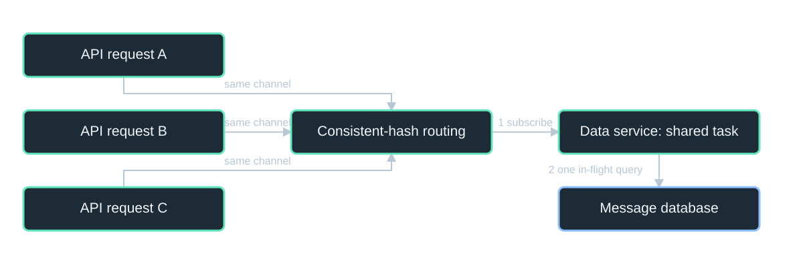

**Diagram scope:** Discord's documented coalescing pattern. One task returns its result to all waiting callers; this is not a persistent result cache.

**Text equivalent:**
- API request A -> Consistent-hash routing: same channel.
- API request B -> Consistent-hash routing: same channel.
- API request C -> Consistent-hash routing: same channel.
- Consistent-hash routing -> Data service: shared task: 1 subscribe.
- Data service: shared task -> Message database: 2 one in-flight query.

### The pattern

Concurrent callers requesting the same key subscribe to one shared in-flight task.

### The real case

Discord added Rust data services between its API monolith and database; consistent-hash routing improved coalescing by channel.

### Instructor explanation and discussion

S10 explicitly describes request coalescing: the first request creates a worker task, later requests subscribe, and the result is returned to all subscribers. This is not a persistent result cache; requests arriving after the task completes may trigger another query. The routing key for messages is channel ID, which directs related traffic to the same data-service instance. The services intentionally contain no business logic and expose roughly one gRPC endpoint per database query. Access control still belongs at appropriate application boundaries; sharing an in-flight result cannot bypass permissions.

**Sources:** [S10: Discord: How Discord Stores Trillions of Messages](https://discord.com/blog/how-discord-stores-trillions-of-messages).

---

## 55. Discord improved the whole storage path

**Appendix: request coalescing / REPORTED RESULT | Optional appendix, outside the lecture clock**

> Its migration combined data services, request coalescing, routing and ScyllaDB.

### Reported historical reads

p99 changed from roughly 40-125 ms on Cassandra to about 15 ms on ScyllaDB.

### Causal caution

The report does not isolate a speedup caused only by coalescing. Hot partitions still existed after the upstream changes.

**~15 ms p99** - Reported post-migration historical-message reads.

### Instructor explanation and discussion

S10 reports the message-store migration completed in May 2022 and was described in March 2023. It also reports 177 Cassandra nodes to 72 ScyllaDB nodes, with different node storage sizes; that is not an apples-to-apples hardware cost comparison. Read the latency result as an observed combined-system outcome. The case is useful because Discord explicitly retained an API monolith while introducing a focused data service. Architectural patterns combine locally rather than replacing every layer of an application.

**Sources:** [S10: Discord: How Discord Stores Trillions of Messages](https://discord.com/blog/how-discord-stores-trillions-of-messages).

---

## 56. Patterns still need an operating environment

**Appendix: full-stack checklist / REFERENCE | Optional appendix, outside the lecture clock**

> Logical application structure does not replace networking, security, deployment or recovery design.

### Edge and network

DNS, TLS, DDoS/WAF, CDN policy, regional ingress, private routes, firewalls, egress and workload identity.

### Operations and data

Multi-AZ replicas, data ownership, global replication/fencing, backups, RTO/RPO, traces, secrets, canaries and compatible schema changes.

### Instructor explanation and discussion

DNS resolves names; it does not proxy application payloads. A WAF filters HTTP traffic; it does not replace resource authorization. A private subnet is not automatically a trusted application identity. NAT is address translation, not an authorization policy. A CDN hit must be compatible with user permissions and cache-key design. Active-active application instances do not imply safe multi-writer data. RTO is the recovery-time objective; RPO is the tolerated data-loss window. Backups must be restored in exercises, because replication can copy corruption. Traces should correlate requests with asynchronous events and projection versions while redacting sensitive data. CI/CD must support version-compatible contracts and staged rollout.

---

## 57. Put the pattern inside a global deployment

**Appendix: global deployment / REFERENCE | Optional appendix, outside the lecture clock**

> The same application structure can run in multiple regions; safe data failover is a separate decision.

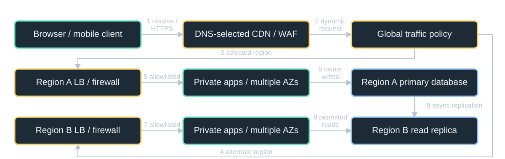

**Diagram scope:** Teaching topology, not a company blueprint. DNS resolution precedes HTTPS; the standby database needs promotion and fencing before it may accept writes.

**Text equivalent:**
- Browser / mobile client -> DNS-selected CDN / WAF: 1 resolve / HTTPS.
- DNS-selected CDN / WAF -> Global traffic policy: 2 dynamic request.
- Global traffic policy -> Region A LB / firewall: 3 selected region.
- Global traffic policy -> Region B LB / firewall: 4 alternate region.
- Region A LB / firewall -> Private apps / multiple AZs: 5 allowlisted.
- Private apps / multiple AZs -> Region A primary database: 6 owner writes.
- Region B LB / firewall -> Private apps / multiple AZs: 7 allowlisted.
- Private apps / multiple AZs -> Region B read replica: 8 permitted reads.
- Region A primary database -> Region B read replica: 9 async replication.

### Public to private

DNS chooses the endpoint; HTTPS crosses DDoS/WAF/CDN controls, regional ingress and private application/data networks.

### Regional failure

Route to healthy capacity, but respect replica lag and write ownership. Promote and fence before accepting writes in the standby region.

### Instructor explanation and discussion

This is a teaching deployment, not an asserted company blueprint. The first arrow represents a DNS lookup followed by the client opening HTTPS to the returned edge endpoint; DNS does not forward the HTTP payload. The edge serves cacheable content or sends dynamic requests to the selected regional load balancer. In each region, firewall/security-group rules allow only required application and database traffic; workload identity and resource authorization remain mandatory. App replicas span availability zones on private networks. The lower database is initially an asynchronous read replica, not an independent writer. During region loss, cached content and permitted reads may continue while write availability depends on promotion, fencing and acceptable RPO. DNS/traffic-policy failover does not instantly replace cached answers or existing connections. Backups protect against corruption that replication can copy. TLS, secrets, controlled egress, tracing and staged deployment apply to both regions.

---

## 58. Sources / S1, S2, S3

**Appendix: sources / EVIDENCE | Optional appendix, outside the lecture clock**

> Dated case evidence, with original links in the footer and full provenance in the notes.

### S1 | Shopify: Deconstructing the Monolith

2019. Primary engineering account: initial monolith, coupling, componentization, Wedge and tax-engine replacement.

### S2 | Netflix: Completing the Netflix Cloud Migration

2016. Primary company report: 2008 database incident, seven-year migration, microservices, regions and organizational change.

### S3 | LinkedIn: Improving and Advancing Kafka

2015. Primary engineering report: shared event infrastructure, consumers, quotas, replication and cross-datacenter delivery.

### Instructor explanation and discussion

All sources were consulted or rechecked for this revision on 2026-11-05. Diagram geometry is original and simplified. The original Netflix Tudum host returned HTTP 403; the attributed author-text republication S5R was inspected and is identified explicitly. Do not silently substitute a secondary summary that claims CQRS was abandoned: the author account describes CQRS with a different implementation. The course format reference S12 informed output formats, not technical claims.

**Sources:** [S1: Shopify: Deconstructing the Monolith](https://shopify.engineering/deconstructing-monolith-designing-software-maximizes-developer-productivity); [S2: Netflix: Completing the Netflix Cloud Migration](https://about.netflix.com/news/completing-the-netflix-cloud-migration); [S3: LinkedIn: Improving and Advancing Kafka](https://www.engineering.linkedin.com/apache-kafka/how-we_re-improving-and-advancing-kafka-linkedin).

---

## 59. Sources / S4, S5, S5R

**Appendix: sources / EVIDENCE | Optional appendix, outside the lecture clock**

> Dated case evidence, with original links in the footer and full provenance in the notes.

### S4 | Martin Fowler: CQRS

2011. Pattern definition: different update/read models; separate databases and event sourcing are not prerequisites.

### S5 | Netflix Tudum: CQRS with Kafka to CQRS with RAW Hollow

2025. Author report by Eugene Yemelyanau and Jake Grice. Original host returned HTTP 403; inspected the attributed republication in S5R. Metrics are reported case results, not independent benchmarks.

### S5R | Attributed republication of the Netflix Tudum article

2025. Retrieval provenance for S5: CMS/Kafka/Cassandra/near-cache path, RAW Hollow revision, seconds vs minutes, ~1.4 s to ~0.4 s homepage construction.

### Instructor explanation and discussion

All sources were consulted or rechecked for this revision on 2026-11-05. Diagram geometry is original and simplified. The original Netflix Tudum host returned HTTP 403; the attributed author-text republication S5R was inspected and is identified explicitly. Do not silently substitute a secondary summary that claims CQRS was abandoned: the author account describes CQRS with a different implementation. The course format reference S12 informed output formats, not technical claims.

**Sources:** [S4: Martin Fowler: CQRS](https://martinfowler.com/bliki/CQRS.html); [S5: Netflix Tudum: CQRS with Kafka to CQRS with RAW Hollow](https://netflixtechblog.com/netflix-tudum-architecture-from-cqrs-with-kafka-to-cqrs-with-raw-hollow-86d141b72e52); [S5R: Attributed republication of the Netflix Tudum article](https://www.blogpivot.app/blog/1/575/netflix-tudum-architecture-from-cqrs-with-kafka-to-cqrs-with-raw-hollow).

---

## 60. Sources / S6, S7, S8

**Appendix: sources / EVIDENCE | Optional appendix, outside the lecture clock**

> Dated case evidence, with original links in the footer and full provenance in the notes.

### S6 | Meta: TAO - The power of the graph

2013. Primary engineering account: graph API, follower/leader caches, MySQL shards, eventual consistency, per-shard primary region.

### S7 | Netflix Open Connect

Live documentation; accessed 2026-11-05. Official delivery architecture: ISP appliances, SFI/peering, BGP, pre-fill and failover to other appliances.

### S8 | TikTok: How TikTok recommends videos #ForYou

2020. Public product behavior and ranking signals; not disclosure of the current internal serving stack.

### Instructor explanation and discussion

All sources were consulted or rechecked for this revision on 2026-11-05. Diagram geometry is original and simplified. The original Netflix Tudum host returned HTTP 403; the attributed author-text republication S5R was inspected and is identified explicitly. Do not silently substitute a secondary summary that claims CQRS was abandoned: the author account describes CQRS with a different implementation. The course format reference S12 informed output formats, not technical claims.

**Sources:** [S6: Meta: TAO - The power of the graph](https://engineering.fb.com/2013/06/25/core-infra/tao-the-power-of-the-graph/); [S7: Netflix Open Connect](https://openconnect.netflix.com/en/); [S8: TikTok: How TikTok recommends videos #ForYou](https://newsroom.tiktok.com/en-us/how-tiktok-recommends-videos-for-you).

---

## 61. Sources / S9, S10, S11

**Appendix: sources / EVIDENCE | Optional appendix, outside the lecture clock**

> Dated case evidence, with original links in the footer and full provenance in the notes.

### S9 | Liu et al.: Monolith

2022. ByteDance-authored paper: BytePlus Recommend deployment, Kafka/Flink online joiner, training/serving parameter servers and incremental synchronization. Not proof of TikTok's exact stack.

### S10 | Discord: How Discord Stores Trillions of Messages

2023. Primary engineering account: API monolith, data services, consistent routing, coalescing, ScyllaDB migration and reported p99 outcomes.

### S11 | Netflix Hystrix

Historical implementation; maintenance mode. Historical evidence for bulkheads, circuit breakers and graceful degradation; not a current dependency recommendation.

### Instructor explanation and discussion

All sources were consulted or rechecked for this revision on 2026-11-05. Diagram geometry is original and simplified. The original Netflix Tudum host returned HTTP 403; the attributed author-text republication S5R was inspected and is identified explicitly. Do not silently substitute a secondary summary that claims CQRS was abandoned: the author account describes CQRS with a different implementation. The course format reference S12 informed output formats, not technical claims.

**Sources:** [S9: Liu et al.: Monolith](https://arxiv.org/html/2209.07663v2); [S10: Discord: How Discord Stores Trillions of Messages](https://discord.com/blog/how-discord-stores-trillions-of-messages); [S11: Netflix Hystrix](https://github.com/Netflix/Hystrix).

---

## Source bibliography and claim scope

### S1. Shopify: Deconstructing the Monolith

**Date:** 2019  
**URL:** <https://shopify.engineering/deconstructing-monolith-designing-software-maximizes-developer-productivity>  
**Scope:** Primary engineering account: initial monolith, coupling, componentization, Wedge and tax-engine replacement.

### S2. Netflix: Completing the Netflix Cloud Migration

**Date:** 2016  
**URL:** <https://about.netflix.com/news/completing-the-netflix-cloud-migration>  
**Scope:** Primary company report: 2008 database incident, seven-year migration, microservices, regions and organizational change.

### S3. LinkedIn: Improving and Advancing Kafka

**Date:** 2015  
**URL:** <https://www.engineering.linkedin.com/apache-kafka/how-we_re-improving-and-advancing-kafka-linkedin>  
**Scope:** Primary engineering report: shared event infrastructure, consumers, quotas, replication and cross-datacenter delivery.

### S4. Martin Fowler: CQRS

**Date:** 2011  
**URL:** <https://martinfowler.com/bliki/CQRS.html>  
**Scope:** Pattern definition: different update/read models; separate databases and event sourcing are not prerequisites.

### S5. Netflix Tudum: CQRS with Kafka to CQRS with RAW Hollow

**Date:** 2025  
**URL:** <https://netflixtechblog.com/netflix-tudum-architecture-from-cqrs-with-kafka-to-cqrs-with-raw-hollow-86d141b72e52>  
**Scope:** Author report by Eugene Yemelyanau and Jake Grice. Original host returned HTTP 403; inspected the attributed republication in S5R. Metrics are reported case results, not independent benchmarks.

### S5R. Attributed republication of the Netflix Tudum article

**Date:** 2025  
**URL:** <https://www.blogpivot.app/blog/1/575/netflix-tudum-architecture-from-cqrs-with-kafka-to-cqrs-with-raw-hollow>  
**Scope:** Retrieval provenance for S5: CMS/Kafka/Cassandra/near-cache path, RAW Hollow revision, seconds vs minutes, ~1.4 s to ~0.4 s homepage construction.

### S6. Meta: TAO - The power of the graph

**Date:** 2013  
**URL:** <https://engineering.fb.com/2013/06/25/core-infra/tao-the-power-of-the-graph/>  
**Scope:** Primary engineering account: graph API, follower/leader caches, MySQL shards, eventual consistency, per-shard primary region.

### S7. Netflix Open Connect

**Date:** Live documentation; accessed 2026-11-05  
**URL:** <https://openconnect.netflix.com/en/>  
**Scope:** Official delivery architecture: ISP appliances, SFI/peering, BGP, pre-fill and failover to other appliances.

### S8. TikTok: How TikTok recommends videos #ForYou

**Date:** 2020  
**URL:** <https://newsroom.tiktok.com/en-us/how-tiktok-recommends-videos-for-you>  
**Scope:** Public product behavior and ranking signals; not disclosure of the current internal serving stack.

### S9. Liu et al.: Monolith

**Date:** 2022  
**URL:** <https://arxiv.org/html/2209.07663v2>  
**Scope:** ByteDance-authored paper: BytePlus Recommend deployment, Kafka/Flink online joiner, training/serving parameter servers and incremental synchronization. Not proof of TikTok's exact stack.

### S10. Discord: How Discord Stores Trillions of Messages

**Date:** 2023  
**URL:** <https://discord.com/blog/how-discord-stores-trillions-of-messages>  
**Scope:** Primary engineering account: API monolith, data services, consistent routing, coalescing, ScyllaDB migration and reported p99 outcomes.

### S11. Netflix Hystrix

**Date:** Historical implementation; maintenance mode  
**URL:** <https://github.com/Netflix/Hystrix>  
**Scope:** Historical evidence for bulkheads, circuit breakers and graceful degradation; not a current dependency recommendation.

### S12. Course format reference

**Date:** Inspected 2026-11-05  
**URL:** <https://github.com/bodonnell-DePaul/webapps_week7>  
**Scope:** Format inspiration: linear HTML/PPTX decks with comprehensive Markdown notes.
